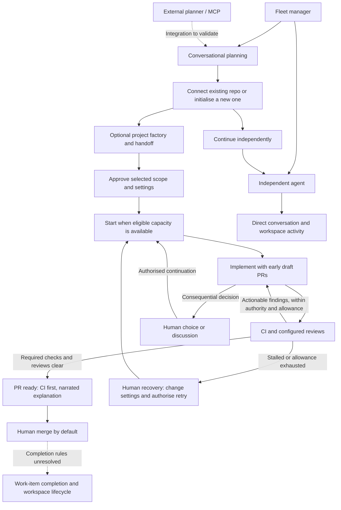

# Marshal web app — end-to-end journeys and remaining gaps

Updated: 2026-11-11 (Australia/Melbourne)

This connects the agreed product behaviour and approved visual directions in [the design record](design-notes.md). It is a synthesis for discussion, not an implementation specification, a claim of working integration, or a change to the independent daemon work. Gap priorities and proposed resolutions below are recommendations, not user decisions.

[High-resolution journey map](screenshots/journey-map.png) · [Map source](journey-map.html)

## Overall journey

The fleet manager is the shared home. Independent agents remain usable without creating a factory. A factory adds a project-scoped handoff, execution, review and repair process. Planning may begin without a repository; resource setup should be available when needed rather than force every user through the entire infrastructure configuration first.

The diagram summarises approved behaviour, but the exact conversion from an independent planning session to a factory work item remains a transition to design. “Start when capacity is available” includes resuming affected work; it does not mean starting a duplicate agent each time a decision is resolved. Multiple PRs can belong to one work item, and one ready/merged PR does not establish completion of all its work.

## Journey 1 — idea to new project

1. Start a conversation with a chosen planner. The editable overview evolves alongside the conversation on desktop; mobile opens into conversation with a clear overview action. Voice is an optional input path, with noninterrupting questions and a quieter mode.
2. Develop the goal, decisions, specifications and plan. The planner can propose a technology stack, scaffold and development environment. These remain discussable and editable.
3. Create a repository on the chosen forge when ready. Review its owner, name, visibility and default branch alongside the scaffold agent's provider/model, environment and placement.
4. By default, establish the scaffold baseline directly on the new repository's default branch. Factory review for this initial scaffold is optional and off. The reviewed-scaffold bootstrap sequence still needs design.
5. Continue planning with the same conversation and documents. Run independent agents or choose a project factory for subsequent implementation. Creating a repo does not imply creating a factory or authorising every feature in the plan.

**Approved visual anchors:** [Planning](screenshots/work-item-desktop.png), [mobile planning](screenshots/work-item-mobile-conversation.png), [new-project setup](screenshots/new-project-desktop.png), [mobile repository setup](screenshots/new-project-mobile.png), [mobile proposal](screenshots/new-project-mobile-proposal.png).

**Transitions to finish:** where repository-free projects live in navigation; setup before a complete feature plan exists; connection setup when no forge/provider is configured; partial creation failure; continuing the conversation after scaffolding; optional reviewed-scaffold bootstrap. The new-project mockup's “Plan ready” label is an example state, not an agreed restriction on repository creation timing.

## Journey 2 — existing repository to independent agent

1. From the fleet, choose a forge/repository, provider/model, environment, workspace and task. Host placement is automatic among eligible hosts unless pinned.
2. Use a new isolated workspace by default, or explicitly resume retained work. Supporting services are isolated per workspace unless shared deliberately.
3. Work through the agent conversation and activity. The user can steer directly. Independent use does not implicitly opt into the factory loop.
4. Keep the workspace until deletion by default; optional automatic cleanup can be configured. Stopping idle compute while preserving work is a proposal whose lifecycle rules remain open.

**Approved visual anchors:** [Fleet](screenshots/fleet-dashboard.png), [Start agent](screenshots/start-agent-desktop.png), [mobile workspace selection](screenshots/start-agent-mobile-environment.png), [resume workspace](screenshots/start-agent-resume.png), [environment editor](screenshots/environment-editor-desktop.png).

**Transitions to finish:** repository import/discovery; independent session landing and end state; adopting existing branches/PRs; concurrent workspace reuse; moving an independent session into a factory without losing context. Full terminal/editor access has not been designed by these mockups.

## Journey 3 — plan to factory delivery

| Stage | Agreed behaviour / approved presentation | Remaining transition |
|---|---|---|
| Choose factory | Optional, project-scoped, starts from plan → implement → review → fix | Creation, editing the process, project-default precedence and conversion from independent work |
| Prepare handoff | Select scope; proposed PR breakdown; implementer/reviewer providers and models; review focuses; planner authority; placement; repair cap, default five | Document revisions, dependencies and precisely what changes count as a new handoff |
| Approve | Authorises execution automatically at eligible capacity | Queue visibility, fairness, explaining ineligibility and dispatch acknowledgement |
| Execute | Draft PRs early; shared activity timeline; direct agent or planner steering; compact progress | PR splitting/reordering, scope changes in flight and steering delivery while agents are busy |
| Review and fix | Required CI and configured reviews inform automatic repairs; stop on stagnation, cap or authority boundary | Iteration accounting, reviewer disagreements, flaky/infra failures and evidence freshness |
| Inspect ready PR | CI above narrated engineering reasoning; passes compact; code optional; surface existing branch previews | Provider permissions/protections, changed-head checks and merge conflicts |
| Merge | Human by default; optional configured automatic merging | Auto-merge policy scope and conditions |
| Close the work | Work item retains plans, conversation, PRs, runs and evidence | Completion criteria across all PRs, reopening, archive, workspace/service cleanup |

**Approved visual anchors:** [Factory](screenshots/factory-dashboard.png), [handoff](screenshots/handoff-desktop.png), [execution](screenshots/execution-desktop.png), [failed-CI review](screenshots/review-v2-combined.png), [ready PR](screenshots/ready-review-desktop.png). The purple workflow overview in the existing factory screenshot is superseded by the user's request to remove it. A compact mobile handoff option is agreed but the exact collapsed treatment remains open.

## Interruptions and return paths

| Interruption | What the user sees / can do | Return path and unresolved details |
|---|---|---|
| Human decision | Consequences, recommended option and easy actions; optional conversation; independent work continues | Authorised affected work resumes at capacity. Revising a decision and concurrent answers need design. [Decision](screenshots/decision-desktop.png) |
| Stagnation / iteration cap | Diagnosis and previous attempts; change provider/model; continue context or fresh handoff; choose more attempts | Retry preserves history. Cross-harness context transfer and iteration counting remain open. [Recovery](screenshots/recovery-desktop.png) |
| Host unreachable | Last contact, unknown current progress, stale readings; ordinary steering queues with edit/cancel | Already-authorised local work can continue. Reconcile events and delivery on return; do not infer failure from disconnection. Duplicate execution prevention and explicit recovery elsewhere need design. [Disconnected](screenshots/host-disconnected-desktop.png), [reconnected](screenshots/host-reconnected-desktop.png) |
| External planner unavailable | Planner responsibility and pending questions need a dedicated presentation | Internal takeover needs approval by default; automatic fallback is user-configurable. MCP/Claude Code two-way operation remains unproven. |
| Phone/browser suspends | Drafts, recordings and uncertain action outcomes need clear recovery | This is distinct from a daemon losing fleet connectivity. Persistence, voice/background support and safe action retries remain open. |

A queued or delivered message is not proof that its requested work is complete. Brief host drops are quiet in notifications; the UI shows disconnection immediately. Persistent drops or blocked progress trigger notification, with a configurable grace period whose default is undecided.

## Shared resources and access

- **Hosts:** private networks/Tailscale first, including access to the web endpoint. Add host offers install-and-connect or connect existing. Show actual capabilities separately from unknown/unavailable ones. [Onboarding](screenshots/host-add-desktop.png), [connected host](screenshots/host-connected-desktop.png).
- **Capacity:** adapt automatically with optional overrides, accounting for unrelated workloads. Hosts may differ in architecture, access and runtime. New placement is distinct from moving an existing host-local workspace.
- **Environments:** approved foundation is Dev Containers CLI/Compose plus native adapters, with Marshal owning workspace lifecycle/admission/placement. Repository edits go through branch/PR by default; optional trials are not a prerequisite. Actual Podman/OrbStack compatibility still needs proof. [Feasibility report](environment-feasibility.md).
- **Connections:** custom Gitea/Forgejo and hosted GitHub/GitLab; provider and harness access; credentials and capability discovery remain to be designed. Optional app login does not settle daemon enrolment or forge/provider authentication.
- **Notifications:** PWA/browser push first; Signal and Element desired; actionable bot replies later if feasible. Mobile can perform main work, not merely receive alerts.

## Prioritised gap list

This is a recommended discussion order, not an approved roadmap. The main problem is unfinished transitions and operating rules, not a shortage of individual screens.

| Priority | Gap | Why it matters | Concrete next design output |
|---|---|---|---|
| 1 | First-use connections and existing-project import | Every route needs suitable model/forge/host access, but configured choices appear without an onboarding path | Connect a forge/provider, discover repository capabilities, and recover from missing permissions while preserving planning |
| 2 | Factory creation and adoption of independent work | The main product promise is optional factories; the transition into one is still underspecified | Create/edit a factory from the working process; map defaults and handoff overrides; adopt a conversation or existing work |
| 3 | Plan revisions and execution changes | Editable, evolving plans must coexist with already-authorised execution | Compare proposed and approved scope, show affected PRs/dependencies, and decide how changed scope takes effect |
| 4 | Completion and retained work | A merged PR can be only part of a feature; retained workspaces consume disk and may contain unfinished changes | Work-item acceptance/completion and reopening; workspace/service stop, retain and delete behaviour |
| 5 | Failure and cancellation semantics | Attractive status screens need trustworthy meanings across asynchronous hosts and forges | Distinguish stop, pause, cancel, retry and recover; define partial setup/dispatch failures and stale instruction handling |
| 6 | Review evidence and readiness | Iterations and review results must not produce false confidence | Counting rules, stagnation signals, failed reviewers, infra/flaky CI and revision-bound evidence |
| 7 | Mobile continuity and access | Phone work includes long planning and consequential actions over private connectivity | Draft recovery, pending action state, keyboard/touch accessibility, PWA push and background voice feasibility |

Technical validation should follow the user's chosen priority rather than interrupt the daemon work: current ACP ownership/contracts, durable events and dispatch, runtime/macOS topology, forge capability differences, Claude Code/MCP interaction and PWA/voice limits all need separate proof. Earlier documentation research is not runtime validation.

## Deliberately lower priority or undecided

Multi-user administration, cross-project factories, multi-repository work, interactive bot replies and ntfy remain lower priority. A coordinator role belongs to later underlying-agent work. Public exposure is undecided. Embedding/forking Gitea remains a research choice, not an agreed requirement. Workspaces cannot be assumed to migrate live between hosts. Marshal should surface existing preview/testing services rather than build separate infrastructure.

## Recommended next conversation

Start with connecting an existing project and discovering what is already usable: forge access, repository instructions, environment definitions and CI. That exercises the fleet-first experience and supplies realistic defaults before discussing factory creation. Keep proposed repository changes explicit; discovery should not silently rewrite an existing project's setup. This recommendation remains open for the user to accept or redirect.
